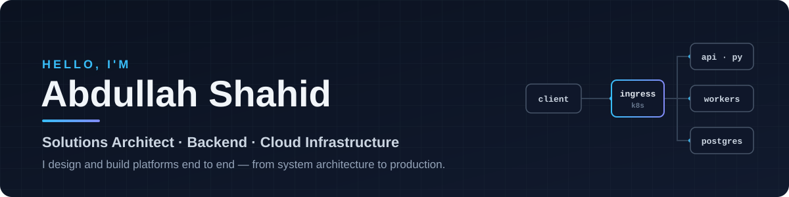
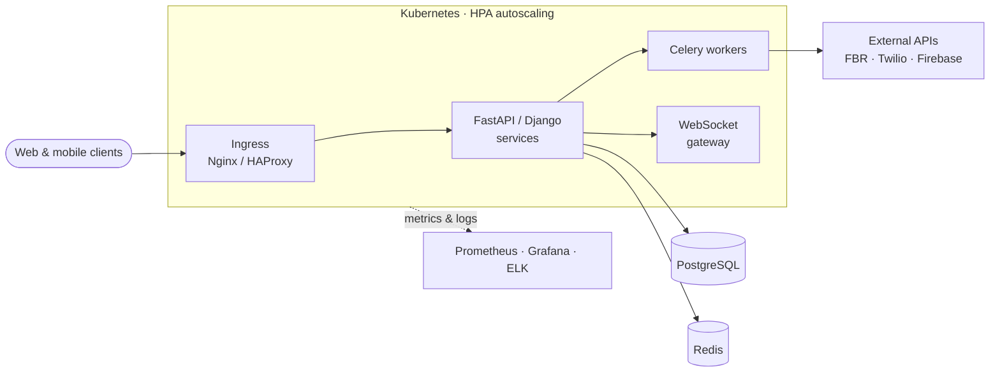

 

---

### About

I'm a **Solutions Architect and senior engineer** with 4+ years of experience taking systems from a whiteboard sketch to production. I turn business requirements into scalable, secure and cost-efficient architectures, and then build them myself: the APIs, the cloud infrastructure, and the monitoring that keeps it all running.

Currently leading the **FBR e-invoicing integration** at **Crypthon Technologies** and running the Kubernetes platform behind it.

<table>
<tr>
<td width="33%" valign="top">

**🏗️ Architecture & Cloud**

System design · microservices
AWS · Kubernetes · Docker
Autoscaling · ingress · CI/CD
Prometheus · Grafana · ELK

</td>
<td width="33%" valign="top">

**⚙️ Backend**

Python · FastAPI · Django · DRF
PostgreSQL · MySQL · Redis
Celery · async · REST APIs
OAuth2 · JWT · RBAC

</td>
<td width="33%" valign="top">

**⚡ Real-time & Frontend**

WebSockets · Django Channels
Firebase · Twilio · voice AI (VAPI)
LLM integration (Ollama)
React

</td>
</tr>
</table>

---

### How I build platforms

A typical architecture I design and run in production:

**Principles I work by:** make it reliable, then make it scale · design for failure · if it isn't monitored, it isn't in production · write it down so the team can own it too.

---

### Experience

| Role | Company | Period |
|---|---|---|
| **Senior Python Developer**: platform architecture, Kubernetes infrastructure, observability, FBR e-invoicing lead | Crypthon Technologies | Feb 2025 – present |
| **Senior Back-End Developer**: auth architecture (OAuth2/JWT/RBAC), query & pagination optimisation | Enigmatix | Aug 2024 – Jan 2025 |
| **Back-End Developer**: REST APIs (DRF, FastAPI), Redis caching, async high-traffic endpoints | Enigmatix | Jul 2023 – Aug 2024 |
| **Associate Back-End Developer**: real-time features (WebSockets, Channels), test coverage | Enigmatix | Jun 2022 – Jul 2023 |

---

### Selected work

| Platform | What I built | Stack |
|---|---|---|
| ⛽ **OMC Solutions**: multi-station fuel management | Inventory, stock and nozzle services · JWT-based RBAC · real-time alerts | FastAPI · PostgreSQL · Firebase · S3 |
| 💰 **Laen Daen**: digital wallet & khata | Wallet and transaction services · encrypted financial data · eCommerce module | FastAPI · PostgreSQL · Firebase |
| 🍔 **Hunger Delights**: multi-restaurant ordering | Order processing · service hours · live delivery & group-order tracking | FastAPI · PostgreSQL · Firebase · S3 |
| 🛒 **Duty Free**: cross-location item exchange | Order, tracking and reward services · role-based permissions | FastAPI · PostgreSQL · Firebase |
| 🏢 **RentAround** + office & restaurant systems | Rentals, scheduling, reservations, inventory and auth | FastAPI · Django · PostgreSQL · Redis · AWS |

These are client and company projects, so their source code is private.

---

### Tech stack

 

---

**Open to Solutions Architect, Senior Full-Stack and Cloud/Platform Engineering roles, and to consulting on scalable system design.**

<a href="https://www.linkedin.com/in/abdullah-shahid-6368a428a/">LinkedIn</a> ·
<a href="mailto:abdullah.shahid.021001@gmail.com">Email</a>

