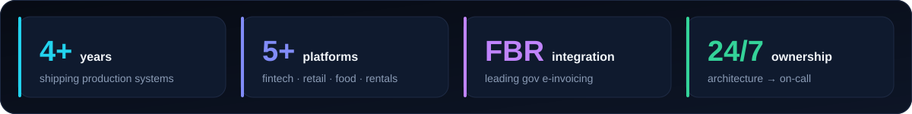
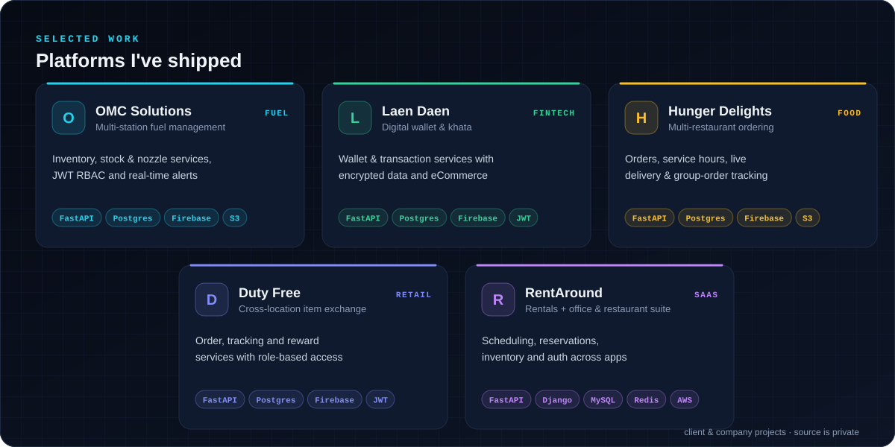
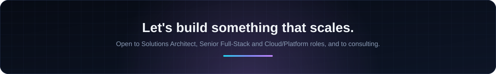

<div align="center">



<a href="https://www.linkedin.com/in/abdullah-shahid-6368a428a/"></a>
<a href="mailto:abdullah.shahid.021001@gmail.com"></a>


<a href="https://github.com/abdullah-540"></a>



</div>

<br/>

<table>
<tr>
<td width="58%" valign="top">

### 👋 About me

I'm a **Solutions Architect and senior engineer** who takes systems from a whiteboard sketch to production, and then keeps them running.

I turn business requirements into **scalable, secure and cost-efficient architectures**, then build them myself: the APIs, the cloud infrastructure, and the monitoring behind them.

Right now I'm leading the **FBR e-invoicing integration** at **Crypthon Technologies** and running the Kubernetes platform it lives on.

</td>
<td width="42%" valign="top">

### 🧭 How I work

```yaml
principles:
  - make it reliable, then make it scale
  - design for failure
  - if it isn't monitored,
    it isn't in production
  - write it down so the team owns it
mode: remote · async · cross-timezone
owns: architecture → deploy → on-call
```

</td>
</tr>
</table>







<br/>

<div align="center">

### 🛠️ Toolbox

<table>
<tr>
<td align="center" width="25%"><b>Backend</b><br/><br/></td>
<td align="center" width="25%"><b>Cloud & Infra</b><br/><br/></td>
<td align="center" width="25%"><b>Data</b><br/><br/></td>
<td align="center" width="25%"><b>Observability</b><br/><br/></td>
</tr>
<tr>
<td align="center"><b>Frontend</b><br/><br/></td>
<td align="center"><b>Delivery</b><br/><br/></td>
<td align="center"><b>Real-time</b><br/><br/></td>
<td align="center"><b>Also</b><br/><br/>


</td>
</tr>
</table>

<br/>



<a href="https://www.linkedin.com/in/abdullah-shahid-6368a428a/"></a>
<a href="mailto:abdullah.shahid.021001@gmail.com"></a>

</div>
